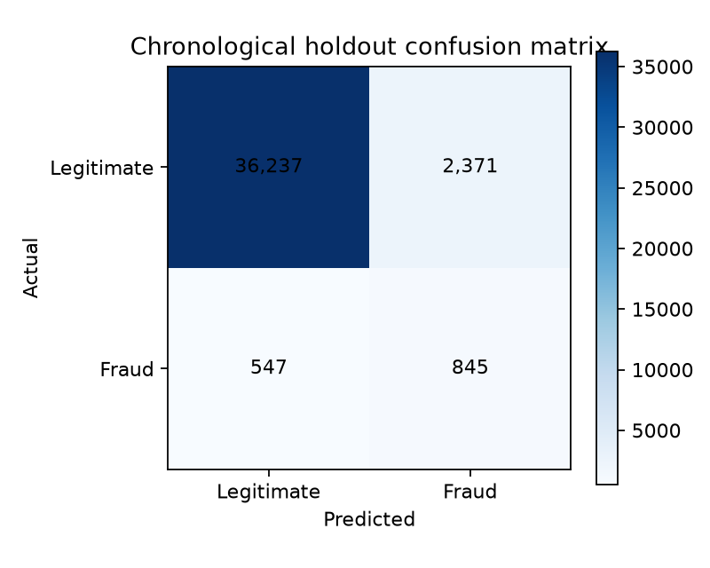
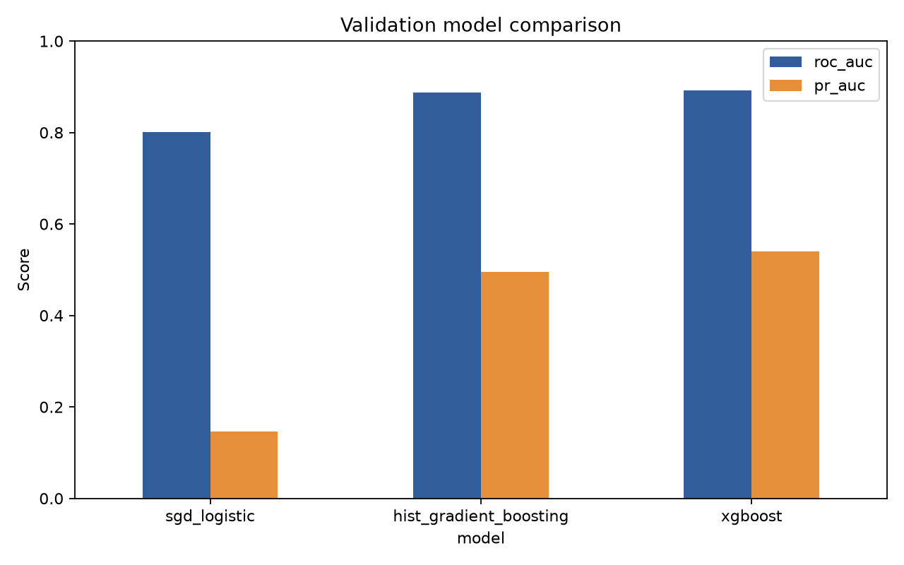
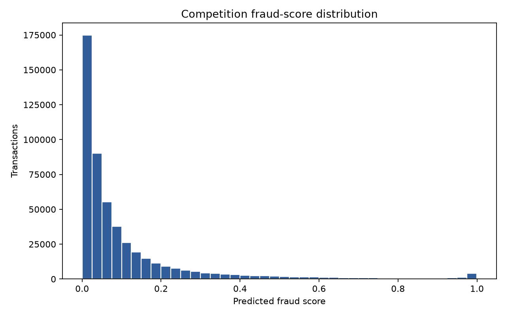

# IEEE-CIS Fraud Detection ML

This is a standalone machine-learning project for the IEEE-CIS Fraud Detection dataset. It is separate
from the BAF project and has its own environment, data links, models, outputs, tests, API, and Git history.

The pipeline merges transaction and identity records by `TransactionID`, uses a chronological
train/validation/test split, compares SGD logistic classification, histogram gradient boosting, and
XGBoost, and selects the model with the highest validation PR-AUC. The held-out internal test period is
not used for selection.

## Dataset source

- [IEEE-CIS Fraud Detection competition and dataset](https://www.kaggle.com/competitions/ieee-fraud-detection)

Kaggle requires an account and acceptance of the competition rules before download. Those rules apply to
the data independently of this project's code licence, so the raw CSV files are not redistributed here.

## Standard team folder layout

| Folder | Purpose |
| --- | --- |
| `checkpoint/` | Production model and model-card links |
| `dataset/` | Direct access to the five supplied `.csv` files |
| `evaluation/` | Metrics, comparison tables, prediction CSV, and PNG charts |
| `preprocess_data/` | Merge, validation, profiling, and hashing entrypoint |
| `preprocessed_df/` | Merged train-ready `.csv.gz` table with split labels |
| `training_model/` | Main model-training and submission entrypoint |
| `utils/` | Shared paths used by the workflow scripts |

### Why some files are intentionally short

Some files in these folders contain only one or two lines because they support the project structure rather
than implement the machine-learning pipeline:

- `.gitkeep` keeps an otherwise empty output folder visible in Git.
- `__init__.py` marks a directory as a Python package and may only contain a package description or version.
- Folder-level `README.md` files briefly describe what belongs in that folder.
- Small CSV and JSON files are generated summaries or metadata, not Python source code.

The main implementation is under `src/ieee_fraud/`. The scripts in `preprocess_data/`, `training_model/`, and
`evaluation/` are convenient entrypoints that call that shared implementation without duplicating it.

Use the standardized workflow from the project root:

```bash
python preprocess_data/run.py
python training_model/train.py
python evaluation/evaluate.py
```

## Project map

| Location | Purpose |
| --- | --- |
| `src/ieee_fraud/data.py` | CSV loading, identity merge, feature preparation, and temporal split |
| `src/ieee_fraud/training.py` | Model comparison, selection, refitting, and prediction CSV creation |
| `src/ieee_fraud/inference.py` | Local JSON prediction |
| `src/ieee_fraud/api.py` | FastAPI prediction service |
| `src/ieee_fraud/profiling.py` | Dataset statistics and SHA-256 evidence |
| `configs/training.json` | Laptop-safe sample limits and model settings |
| `outputs/test_predictions.csv` | Kaggle-format `TransactionID,isFraud` output |
| `artifacts/model_card.json` | Split, selection, metrics, and configuration record |
| `docs/DATASET.md` | Dataset handling notes |

## Evaluation results

Team members can start from the [evaluation guide](evaluation/README.md) or open the
[complete outputs folder](outputs/). The main report figures are linked below.

- [Confusion matrix](outputs/confusion_matrix.png)
- [Model comparison chart](outputs/model_comparison.png)
- [Prediction distribution](outputs/prediction_distribution.png)
- [Model comparison table](outputs/model_comparison.csv)
- [Complete metrics](outputs/metrics.json)







XGBoost was selected by validation PR-AUC (0.5403). On the held-out internal test period it achieved
PR-AUC **0.4795**, ROC-AUC **0.8876**, precision **0.2627**, recall **0.6070**, and F1 **0.3668**.
The validation threshold targets a 5% false-positive rate; the observed test false-positive rate was
6.14% under temporal drift.

## Setup in PyCharm

Open this folder as the project:

```text
/Users/daoduykha/Documents/Playground/ieee-fraud-ml
```

This computer is already configured to use the project-local interpreter:

```text
/Users/daoduykha/Documents/Playground/ieee-fraud-ml/.venv/bin/python
```

For a fresh clone on another computer, create the same environment in PyCharm's terminal:

```bash
python3 -m venv .venv
source .venv/bin/activate
python -m pip install -e ".[dev]"
```

Select `.venv/bin/python` under **Settings > Project > Python Interpreter**. The included
`environment.yml` remains available for teammates who prefer Conda.

## Connect the supplied data

The linking command avoids making another 1.3 GB copy:

```bash
python scripts/link_data.py "/Users/daoduykha/Downloads/ieee-fraud-detection 2"
```

Confirm the links:

```bash
ls -lh data/raw
```

Raw files are ignored by Git.

## Train and create the output CSV

```bash
python -m ieee_fraud.training
```

The command creates:

- `artifacts/production_model.joblib`
- `artifacts/model_card.json`
- `outputs/model_comparison.csv`
- `outputs/metrics.json`
- `outputs/test_predictions.csv`

The last file is the prediction output for all rows in `test_transaction.csv`, using the same columns as
`sample_submission.csv`.

The default configuration trains on a reproducible class-stratified sample from each chronological period
to fit on a laptop. Change the `max_*_rows` values in `configs/training.json` to `null` to train on all
available labeled rows.

## Profile the dataset

```bash
python -m ieee_fraud.profiling
```

This writes `outputs/dataset_profile.json` with row counts, fraud rate, missingness, file sizes, and hashes.
Hashing all 1.3 GB can take several minutes.

## Run the API

```bash
python -m uvicorn ieee_fraud.api:app --host 127.0.0.1 --port 8020
```

Open <http://127.0.0.1:8020/docs>. The root endpoint is also implemented, so opening
<http://127.0.0.1:8020/> will not return a 404.

Example request body:

```json
{
  "features": {
    "TransactionAmt": 68.5,
    "ProductCD": "W",
    "card1": 13926,
    "card4": "discover",
    "card6": "credit"
  }
}
```

## Command-line prediction

```bash
python -m ieee_fraud.inference examples/sample_transaction.json
```

## Verification

```bash
pytest -q
ruff check .
```

This is an educational decision-support prototype. A high score means human review is recommended; it is
not proof of fraud and must not automatically reject or block a transaction.

