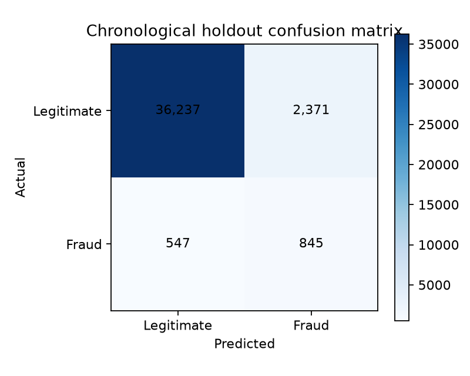
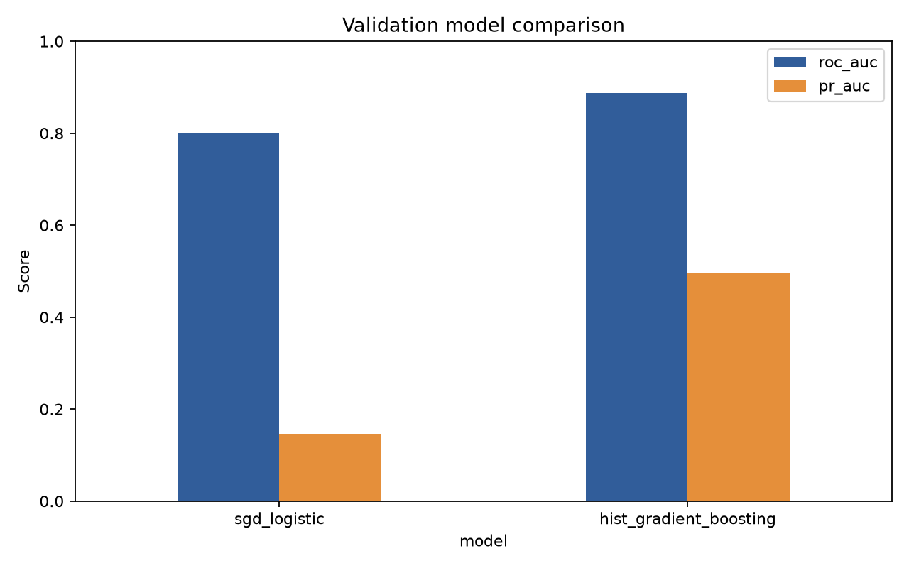
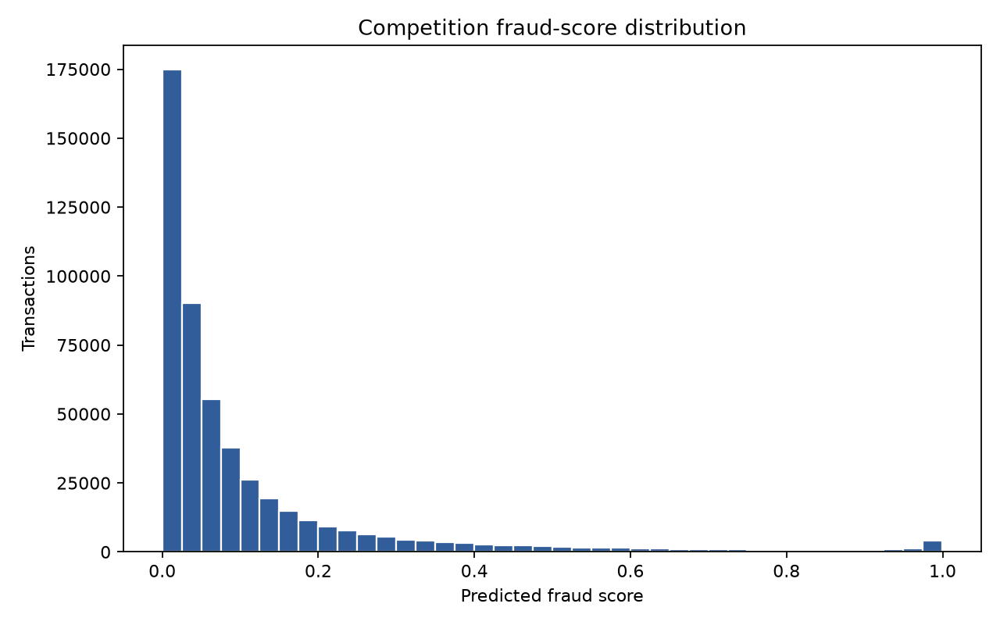

# Evaluation

`results` points to `outputs/`, including metrics, comparison tables, dataset profiles, charts, and the
Kaggle-format prediction CSV. Run `python evaluation/evaluate.py` to refresh the PNG charts and print a
concise terminal summary.

## Find the results

- [Open every committed evaluation file](../outputs/)
- [Model comparison table](../outputs/model_comparison.csv)
- [Complete evaluation metrics](../outputs/metrics.json)
- [Dataset profile](../outputs/dataset_profile.json)
- [Confusion matrix](../outputs/confusion_matrix.png)
- [Model comparison chart](../outputs/model_comparison.png)
- [Prediction distribution](../outputs/prediction_distribution.png)

### Confusion matrix preview

### Model comparison preview

### Prediction distribution preview

